# Power Test Results — nRF54L15 DK / nRF54LM20 DK / nRF54LS05 DK

English | [中文](power_results.zh.md)

Updated: 2026-10-27

## 1. Test conditions

| Item | Detail |
|---|---|
| Boards | nRF54L15 DK v1.0.0 (PCA10156), SoC **nRF54L15 Rev 2**; nRF54LM20 DK v0.7.0, SoC **nRF54LM20B Engineering B (ENGB)**; nRF54LS05 DK v0.3.1, SoC **nRF54LS05B Rev 1** |
| SDK | NCS v3.4.0 (nRF54L15, nRF54LM20); NCS v3.4.1 (nRF54LS05) |
| Firmware | Systemon sample; `CONFIG_PM_DEVICE` and `PM_DEVICE_RUNTIME` enabled; DC/DC enabled |
| Variables | RAM: unused part turned off (`ramtrim`) / all RAM powered (`ram_all.conf`); low-frequency clock: LFXO (default) / LFRC (`lfrc.conf`, `CALIBRATION_PERIOD=4000`, `MAX_SKIP` left at its default of 1) |
| Supply | External supply on the VDD current-measurement header (P6 on the L15, jumper removed; on the LM20 follow the silkscreen), **3.0 V**; USB stays connected |
| Instrument | PPK2 (E0E12B217AD6), Nordic Power Profiler app, source-meter mode 3000 mV, 100 000 samples/s; the window of every figure is 1 minute |

## 2. Results

Average current in µA, taken from the 1-minute window of each figure. The per-figure data is also saved in [power_results.csv](power_results.csv).

| Configuration | nRF54L15 | nRF54LM20B (ENGB) | nRF54LS05B |
|---|---|---|---|
| LFXO, unused RAM turned off | **1.45** (Figure 1) | **1.43** (Figure 5) | **1.11** (Figure 9) |
| LFXO, all RAM powered | **3.33** (Figure 2) | **3.51** (Figure 6) | **1.77** (Figure 10) |
| LFRC, unused RAM turned off | **2.75** (Figure 3) | **2.81** (Figure 7) | **2.36** (Figure 11) |
| LFRC, all RAM powered | **4.67** (Figure 4) | **4.93** (Figure 8) | **3.15** (Figure 12) |

## 3. Waveforms

### 3.1 nRF54L15: LFXO, unused RAM turned off

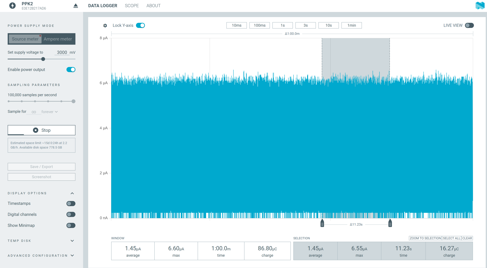

*Figure 1: nRF54L15 DK, LFXO, unused RAM turned off, 3.0 V. Y axis 0–8 µA.*

Average current (1-minute window): **1.45 µA**

### 3.2 nRF54L15: LFXO, all RAM powered

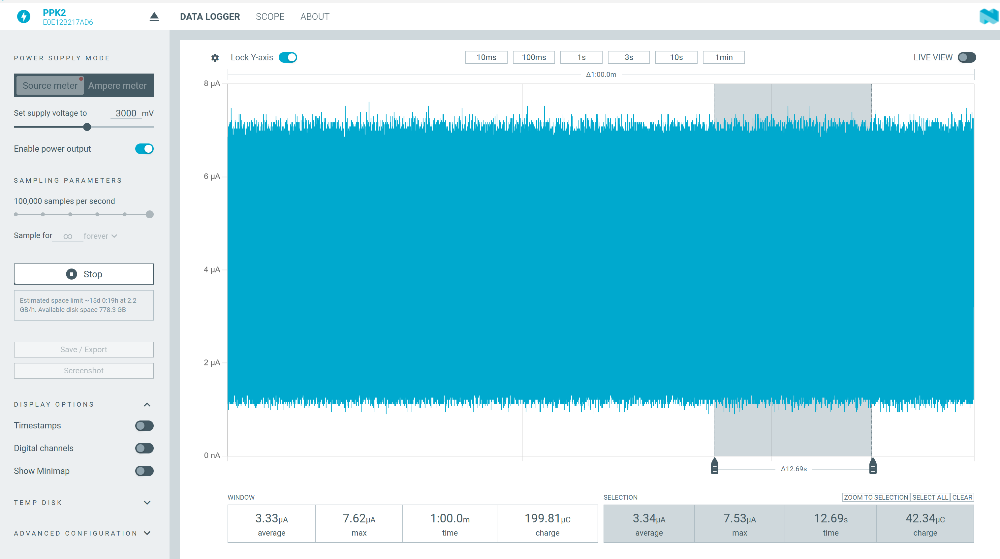

*Figure 2: nRF54L15 DK, LFXO, all RAM powered, 3.0 V. Y axis 0–8 µA.*

Average current (1-minute window): **3.33 µA**

### 3.3 nRF54L15: LFRC (calibration every 4 s), unused RAM turned off

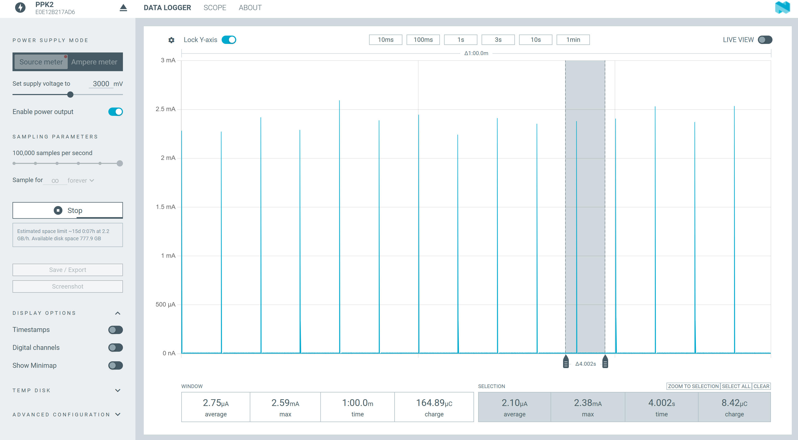

*Figure 3: nRF54L15 DK, LFRC, unused RAM turned off, 3.0 V. Y axis 0–3 mA.*

Average current (1-minute window): **2.75 µA**

### 3.4 nRF54L15: LFRC (calibration every 4 s), all RAM powered

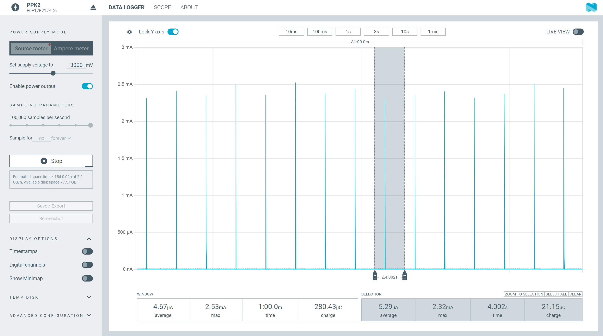

*Figure 4: nRF54L15 DK, LFRC, all RAM powered, 3.0 V. Y axis 0–3 mA.*

Average current (1-minute window): **4.67 µA**

### 3.5 nRF54LM20B: LFXO, unused RAM turned off

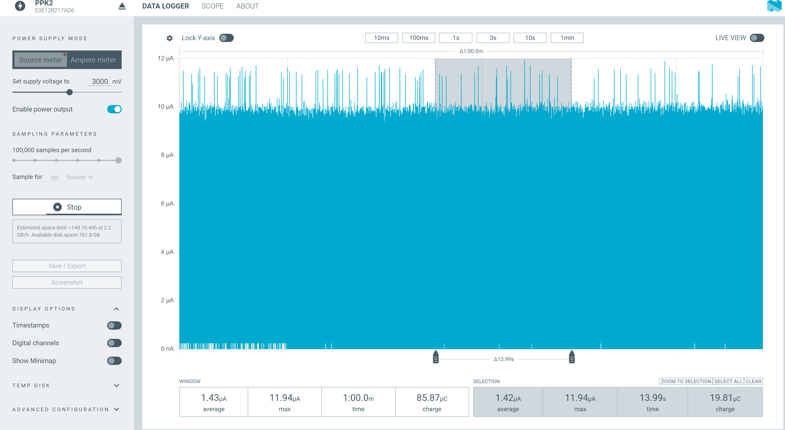

*Figure 5: nRF54LM20B DK, LFXO, unused RAM turned off, 3.0 V. Y axis 0–12 µA.*

Average current (1-minute window): **1.43 µA**

### 3.6 nRF54LM20B: LFXO, all RAM powered

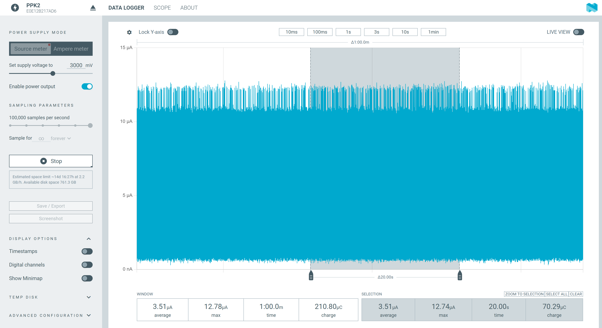

*Figure 6: nRF54LM20B DK, LFXO, all RAM powered, 3.0 V. Y axis 0–15 µA.*

Average current (1-minute window): **3.51 µA**

### 3.7 nRF54LM20B: LFRC (calibration every 4 s), unused RAM turned off

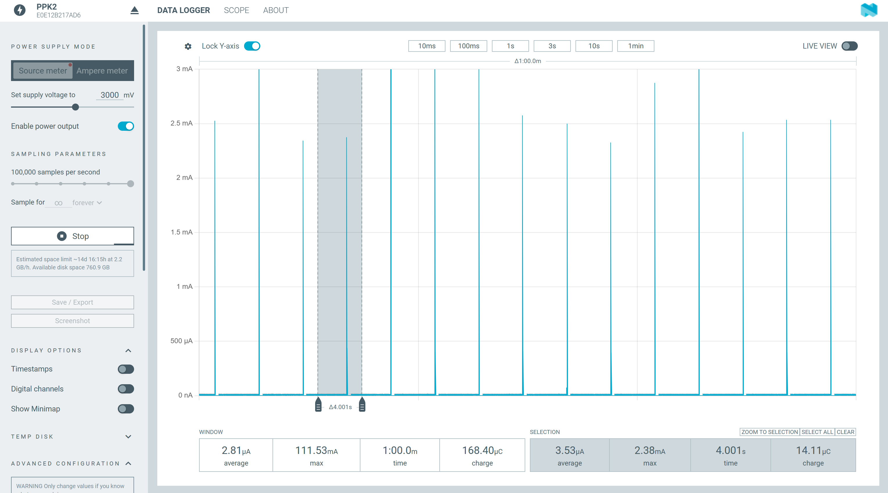

*Figure 7: nRF54LM20B DK, LFRC, unused RAM turned off, 3.0 V. Y axis 0–3 mA.*

Average current (1-minute window): **2.81 µA**

### 3.8 nRF54LM20B: LFRC (calibration every 4 s), all RAM powered

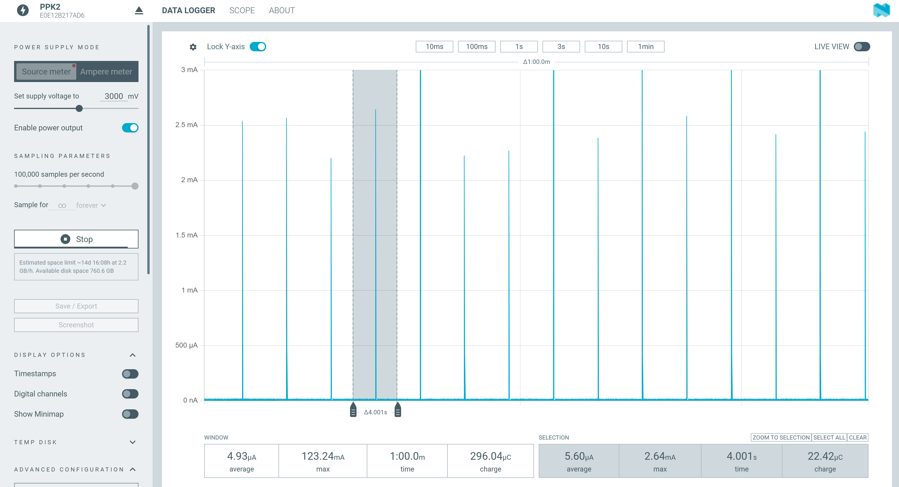

*Figure 8: nRF54LM20B DK, LFRC, all RAM powered, 3.0 V. Y axis 0–3 mA.*

Average current (1-minute window): **4.93 µA**

### 3.9 nRF54LS05B: LFXO, unused RAM turned off

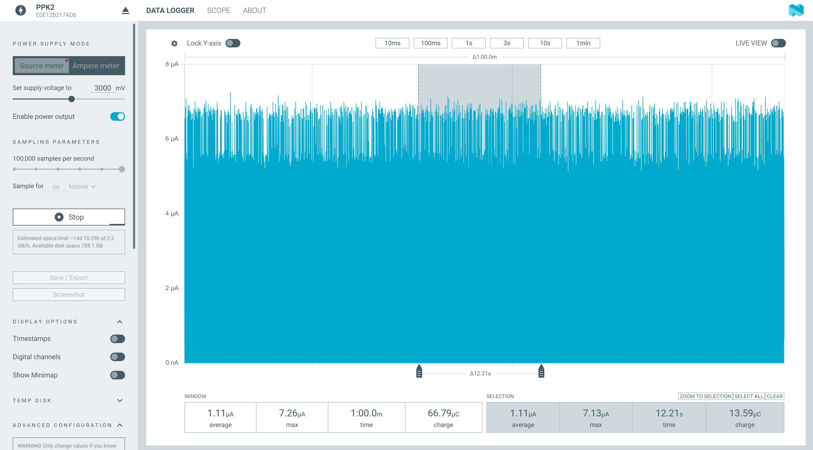

*Figure 9: nRF54LS05 DK, LFXO, unused RAM turned off, 3.0 V, 100 000 samples/s. Y axis 0–8 µA.*

Average current (1-minute window): **1.11 µA**, window maximum 7.26 µA, charge 66.79 µC.

### 3.10 nRF54LS05B: LFXO, all RAM powered

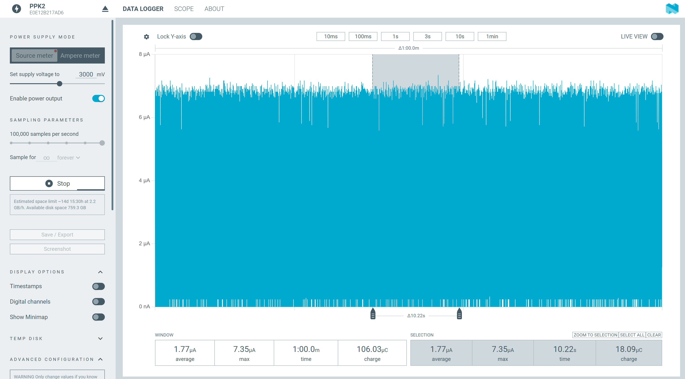

*Figure 10: nRF54LS05 DK, LFXO, all RAM powered, 3.0 V, 100 000 samples/s. Y axis 0–8 µA.*

Average current (1-minute window): **1.77 µA**, window maximum 7.35 µA, charge 106.03 µC.

### 3.11 nRF54LS05B: LFRC (calibration every 4 s), unused RAM turned off

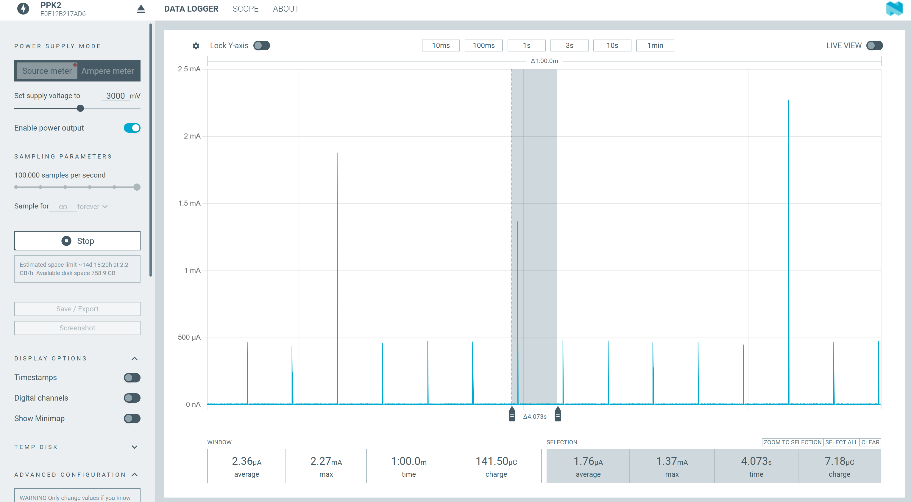

*Figure 11: nRF54LS05 DK, LFRC, unused RAM turned off, 3.0 V, 100 000 samples/s. Y axis 0–2.5 mA.*

Average current (1-minute window): **2.36 µA**, window maximum 2.27 mA, charge 141.50 µC. A calibration pulse of about 0.5 mA occurs roughly every 4 s; a few individual pulses are higher (about 1.4–2.3 mA).

### 3.12 nRF54LS05B: LFRC (calibration every 4 s), all RAM powered

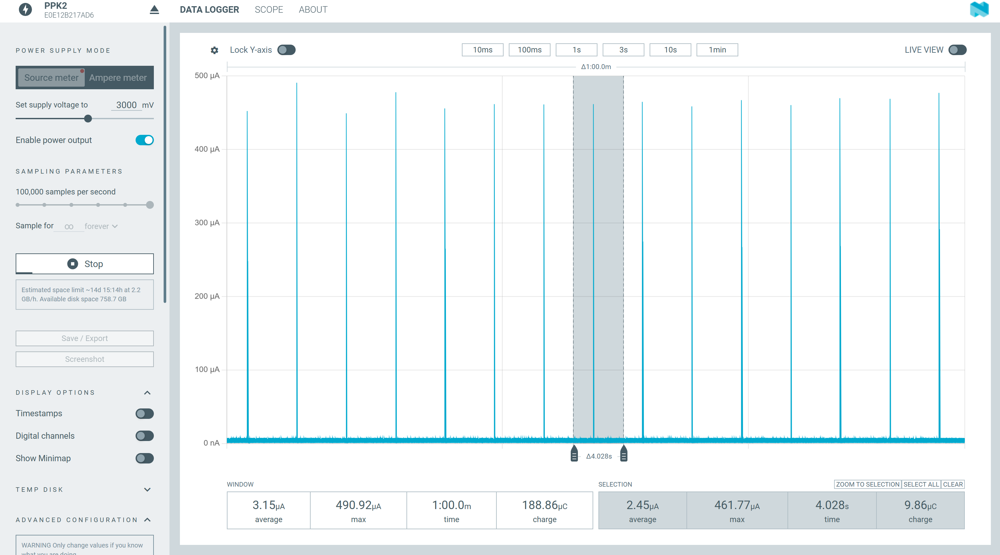

*Figure 12: nRF54LS05 DK, LFRC, all RAM powered, 3.0 V, 100 000 samples/s. Y axis 0–500 µA.*

Average current (1-minute window): **3.15 µA**, window maximum 490.92 µA, charge 188.86 µC. A calibration pulse of about 450–490 µA occurs roughly every 4 s.

## 4. Datasheet reference values

The values below come from the datasheets; they are not data from this test.

### 4.1 nRF54L15 (Datasheet, Current consumption)

Test conditions: 3 V, 25 °C, DC/DC, CPU in WFI/WFE sleep, peripherals idle, HFCLK = HFINT 128 MHz. Typical values, in µA.

| Symbol | Description | Typ. |
|---|---|---|
| IOFF0 | System OFF, Wake on pin, 0 KB RAM retained | 0.7 |
| IOFF1 | System OFF, Wake on pin + GRTC, LFXO, 0 KB RAM retained | 0.9 |
| ION_IDLE0 | System ON, Wake on pin, 0 KB RAM retained | 0.8 |
| ION_IDLE1 | System ON, Wake on pin, 64 KB RAM retained | 1.3 |
| ION_IDLE2 | System ON, Wake on pin, 96 KB RAM retained | 1.5 |
| ION_IDLE3 | System ON, Wake on pin, 128 KB RAM retained | 1.8 |
| ION_IDLE4 | System ON, Wake on pin, 192 KB RAM retained | 2.3 |
| ION_IDLE5 | System ON, Wake on pin, 256 KB RAM retained | 2.7 |
| ION_IDLE6 | System ON, Wake on pin + GRTC, LFXO, 64 KB RAM retained | 1.5 |
| ION_IDLE7 | System ON, Wake on pin + GRTC, LFXO, 128 KB RAM retained | 1.9 |
| ION_IDLE8 | System ON, Wake on pin + GRTC, LFXO, 256 KB RAM retained | 2.9 |
| ION_IDLE9 | System ON, Wake on pin + GRTC, LFRC, 256 KB RAM retained | 3.5 |

Low-frequency clock (LFCLK): the LFRC error is at most ±4.5% uncalibrated and at most ±250 ppm after calibration (temperature change within ±0.5 °C, calibrated at least every 8 s); the LFXO start-up time is typically 0.43 s and the LFRC start-up time typically 1000 µs.

### 4.2 nRF54LM20A / nRF54LM20B (Datasheet v1.0, Current consumption)

Test conditions: 3 V on VDD, 25 °C, DC/DC, CPU in WFI/WFE sleep, peripherals idle, HFCLK = HFINT 128 MHz, LFCLK not running (unless the row says otherwise). In System ON the RAM value is the amount of RAM that is powered; in System OFF it is the amount of RAM that is retained. Typical values, in µA.

| Symbol | Description | Typ. |
|---|---|---|
| IOFF0 | System OFF, Wake on pin, 0 KB RAM retained | 0.7 |
| IOFF1 | System OFF, Wake on pin + GRTC, LFXO, 0 KB RAM retained | 1.0 |
| IONIDLE0 | System ON, Wake on pin, 32 KB RAM retained | 1.1 |
| IONIDLE1 | System ON, Wake on pin, 512 KB RAM retained | 4.0 |
| IONIDLE2 | System ON, Wake on pin + GRTC, LFXO, 512 KB RAM retained | 4.3 |

### 4.3 nRF54LS05A / nRF54LS05B (Datasheet, Current consumption)

The datasheet marks these values as **Estimated**; they are not final test values. The test conditions were not retrieved here (the conditions for the L15 and LM20 are 3 V, 25 °C, DC/DC, CPU sleeping, peripherals idle), so the table can only be compared roughly with the two tables above. Typical values, in µA.

| Symbol | Description | Typ. |
|---|---|---|
| IOFF0 | System OFF, Wake on pin, 0 KB RAM retained | 0.6 |
| IOFF1 | System OFF, Wake on pin + GRTC, LFXO, 0 KB RAM retained | 0.7 |
| IONIDLE | System ON, Wake on pin + GRTC, LFXO, 96 KB RAM | 1.2 |
