# 功耗测试记录 — nRF54L15 DK / nRF54LM20 DK / nRF54LS05 DK

[English](power_results.md) | 中文

更新日期:2026-10-27

## 1. 测试条件

| 项目 | 内容 |
|---|---|
| 板子 | nRF54L15 DK v1.0.0(PCA10156),SoC **nRF54L15 Rev 2**;nRF54LM20 DK v0.7.0,SoC **nRF54LM20B Engineering B(ENGB)**;nRF54LS05 DK v0.3.1,SoC **nRF54LS05B Rev 1** |
| SDK | NCS v3.4.0(nRF54L15、nRF54LM20);NCS v3.4.1(nRF54LS05) |
| 固件 | systemon sample;`CONFIG_PM_DEVICE`、`PM_DEVICE_RUNTIME` 开启;DC/DC 开启 |
| 变量 | RAM:关闭不用的部分(`ramtrim`)/ 全部上电(`ram_all.conf`);低频时钟:LFXO(默认)/ LFRC(`lfrc.conf`,`CALIBRATION_PERIOD=4000`,`MAX_SKIP` 用默认值 1) |
| 供电 | 外部电源接 VDD 电流测量排针(L15 是 P6,拔掉跳线;LM20 以板上丝印为准),**3.0 V**;USB 保持连接 |
| 仪表 | PPK2(E0E12B217AD6),Nordic Power Profiler 应用,源表模式 3000 mV,100 000 样点/秒;每张图的窗口是 1 分钟 |

## 2. 测试结果

平均电流,单位 µA,取每张图的 1 分钟窗口平均值。逐张图的数据另存为 [power_results.csv](power_results.csv)。

| 配置 | nRF54L15 | nRF54LM20B(ENGB) | nRF54LS05B |
|---|---|---|---|
| LFXO,关闭不用的 RAM | **1.45**(图 1) | **1.43**(图 5) | **1.11**(图 9) |
| LFXO,RAM 全开 | **3.33**(图 2) | **3.51**(图 6) | **1.77**(图 10) |
| LFRC,关闭不用的 RAM | **2.75**(图 3) | **2.81**(图 7) | **2.36**(图 11) |
| LFRC,RAM 全开 | **4.67**(图 4) | **4.93**(图 8) | **3.15**(图 12) |

## 3. 波形

### 3.1 nRF54L15:LFXO、关闭不用的 RAM

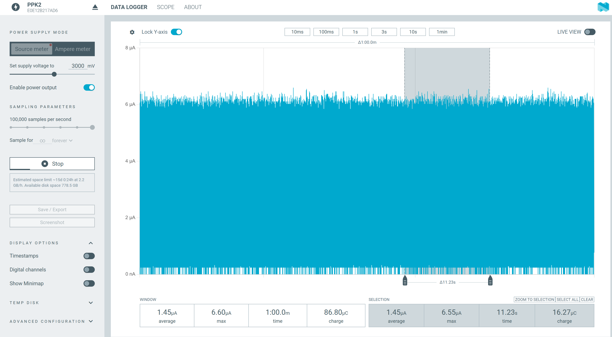

*图 1:nRF54L15 DK,LFXO,关闭不用的 RAM,3.0 V。纵轴 0~8 µA。*

平均电流(1 分钟窗口):**1.45 µA**

### 3.2 nRF54L15:LFXO、RAM 全开

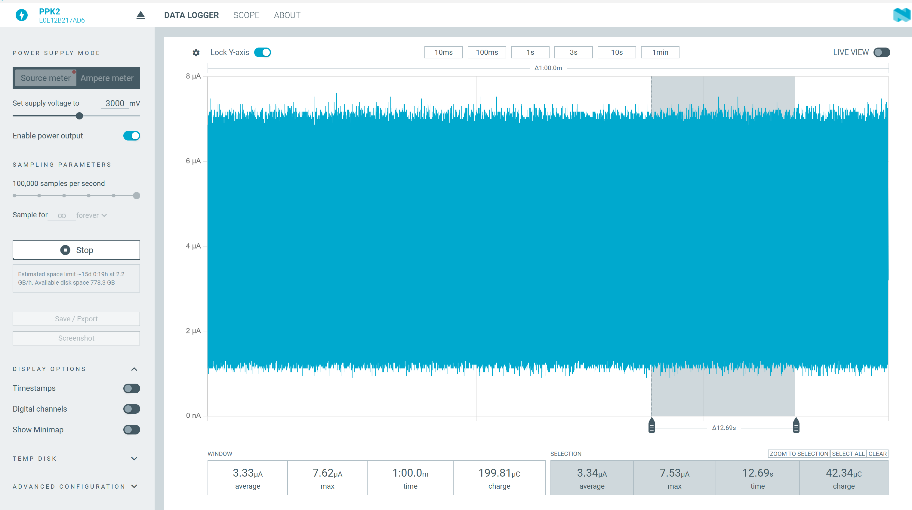

*图 2:nRF54L15 DK,LFXO,RAM 全开,3.0 V。纵轴 0~8 µA。*

平均电流(1 分钟窗口):**3.33 µA**

### 3.3 nRF54L15:LFRC(每 4 秒校准)、关闭不用的 RAM

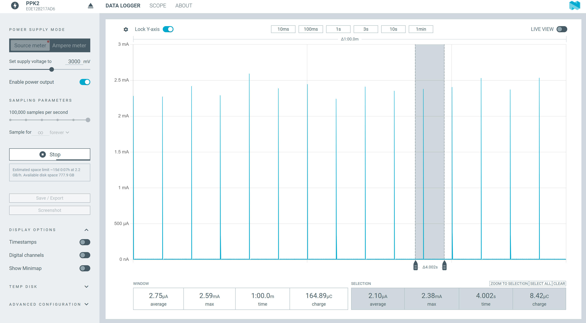

*图 3:nRF54L15 DK,LFRC,关闭不用的 RAM,3.0 V。纵轴 0~3 mA。*

平均电流(1 分钟窗口):**2.75 µA**

### 3.4 nRF54L15:LFRC(每 4 秒校准)、RAM 全开

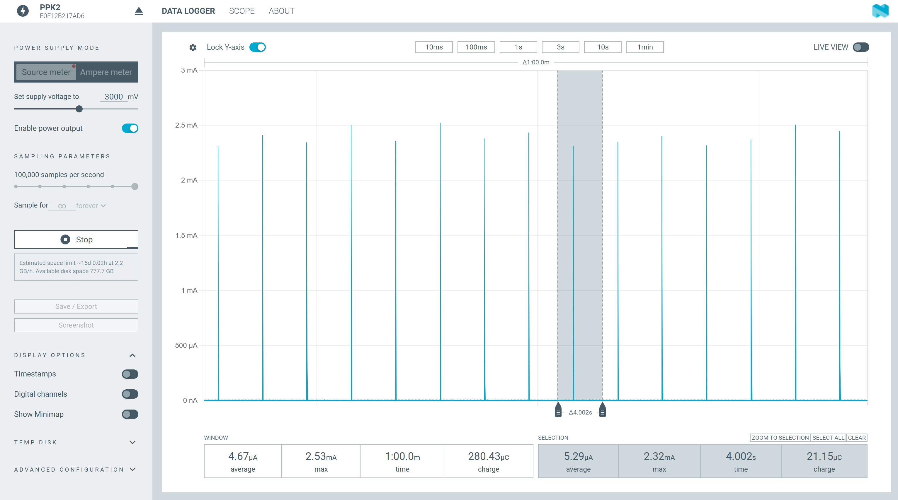

*图 4:nRF54L15 DK,LFRC,RAM 全开,3.0 V。纵轴 0~3 mA。*

平均电流(1 分钟窗口):**4.67 µA**

### 3.5 nRF54LM20B:LFXO、关闭不用的 RAM

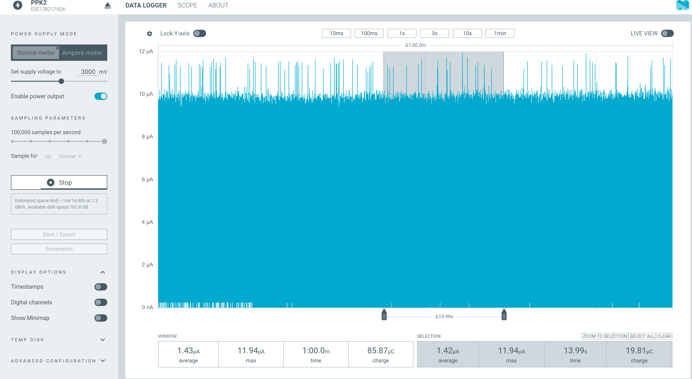

*图 5:nRF54LM20B DK,LFXO,关闭不用的 RAM,3.0 V。纵轴 0~12 µA。*

平均电流(1 分钟窗口):**1.43 µA**

### 3.6 nRF54LM20B:LFXO、RAM 全开

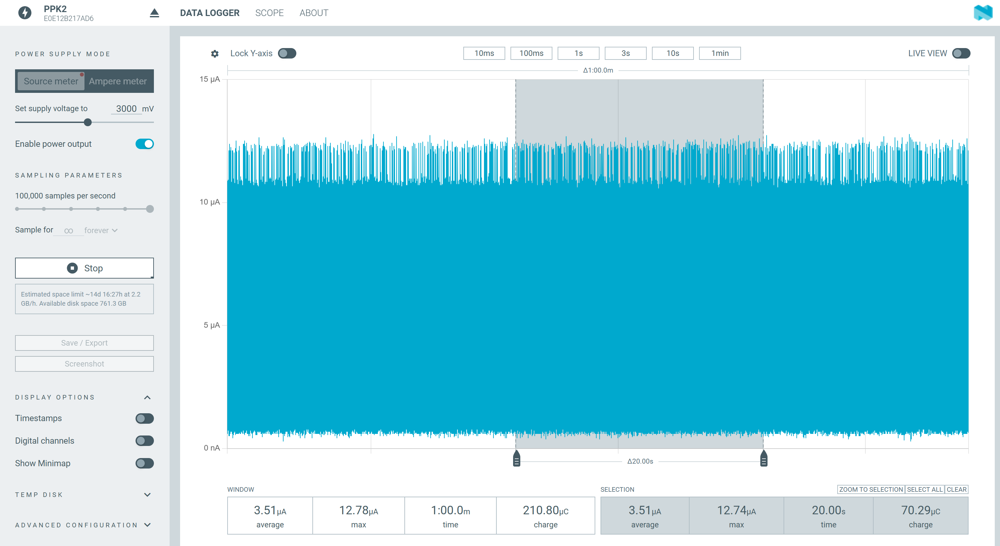

*图 6:nRF54LM20B DK,LFXO,RAM 全开,3.0 V。纵轴 0~15 µA。*

平均电流(1 分钟窗口):**3.51 µA**

### 3.7 nRF54LM20B:LFRC(每 4 秒校准)、关闭不用的 RAM

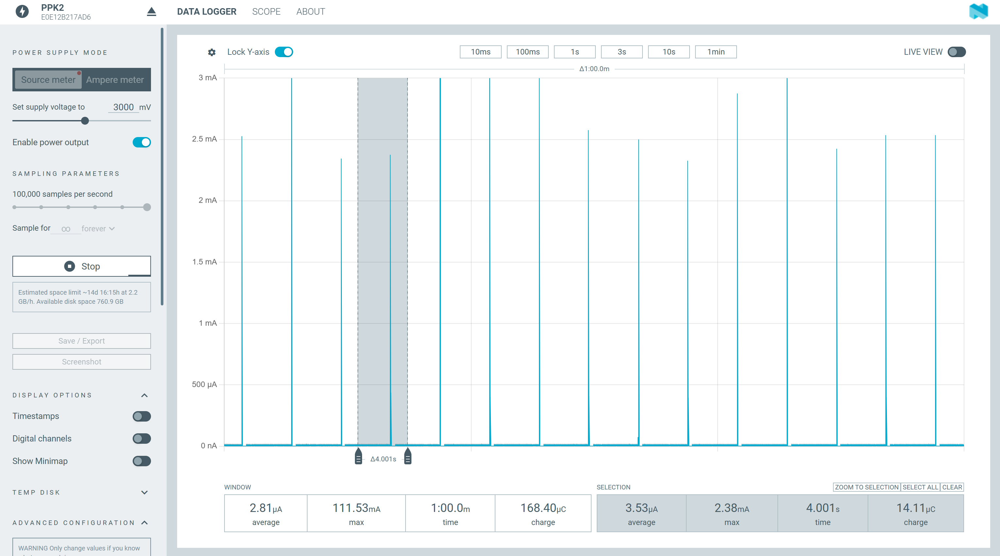

*图 7:nRF54LM20B DK,LFRC,关闭不用的 RAM,3.0 V。纵轴 0~3 mA。*

平均电流(1 分钟窗口):**2.81 µA**

### 3.8 nRF54LM20B:LFRC(每 4 秒校准)、RAM 全开

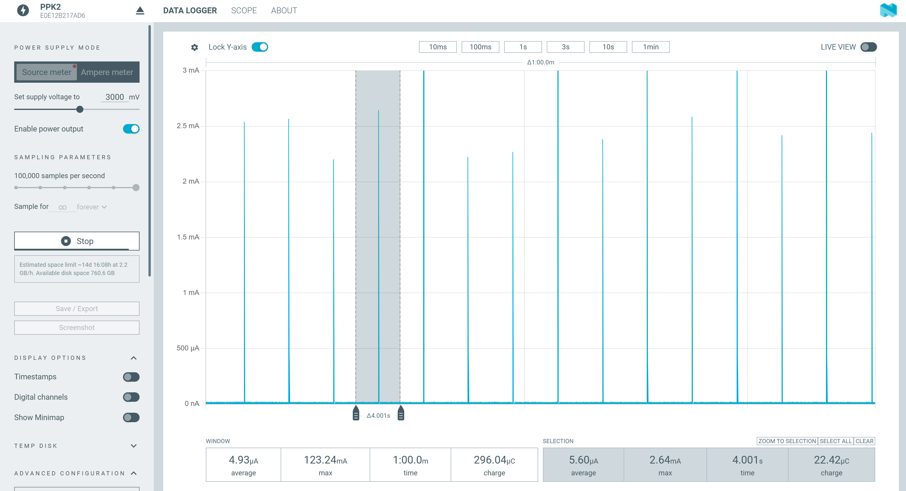

*图 8:nRF54LM20B DK,LFRC,RAM 全开,3.0 V。纵轴 0~3 mA。*

平均电流(1 分钟窗口):**4.93 µA**

### 3.9 nRF54LS05B:LFXO、关闭不用的 RAM

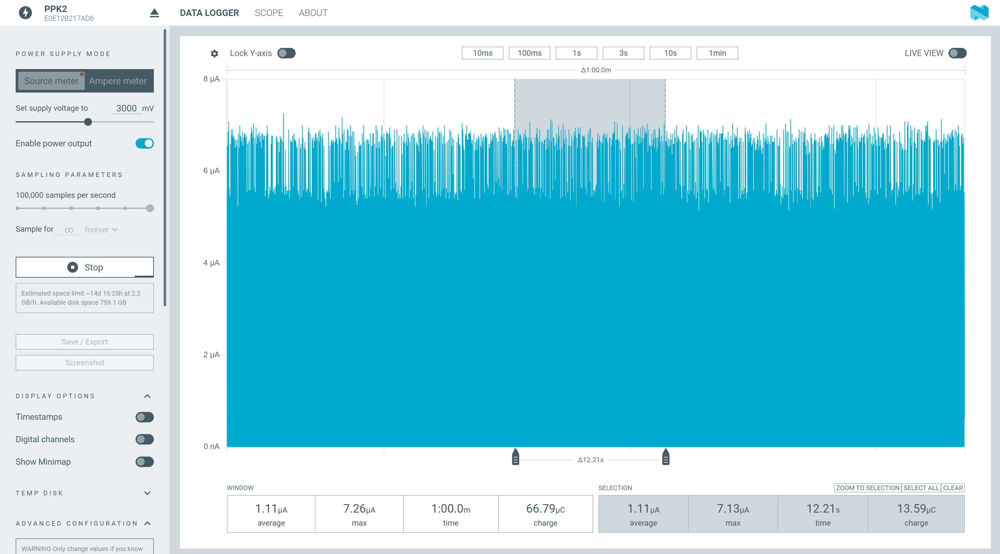

*图 9:nRF54LS05 DK,LFXO,关闭不用的 RAM,3.0 V,100 000 样点/秒。纵轴 0~8 µA。*

平均电流(1 分钟窗口):**1.11 µA**,窗口最大 7.26 µA,电荷 66.79 µC。

### 3.10 nRF54LS05B:LFXO、RAM 全开

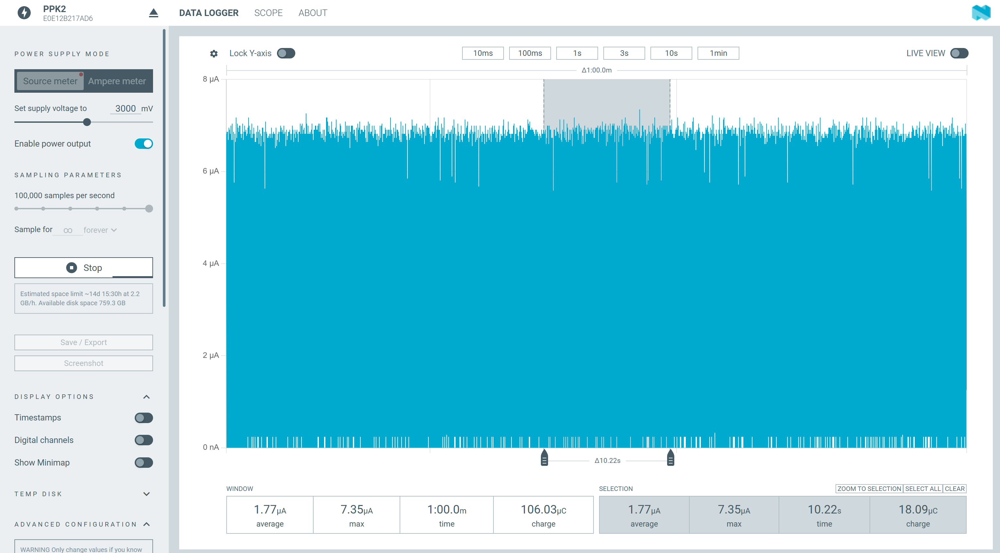

*图 10:nRF54LS05 DK,LFXO,RAM 全开,3.0 V,100 000 样点/秒。纵轴 0~8 µA。*

平均电流(1 分钟窗口):**1.77 µA**,窗口最大 7.35 µA,电荷 106.03 µC。

### 3.11 nRF54LS05B:LFRC(每 4 秒校准)、关闭不用的 RAM

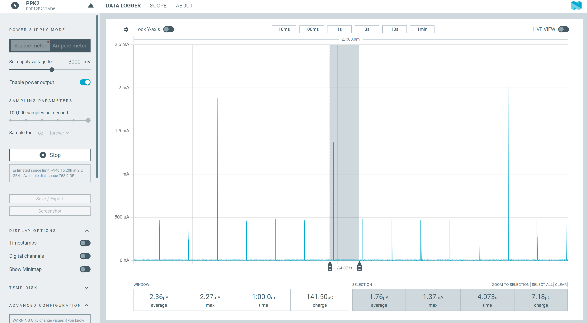

*图 11:nRF54LS05 DK,LFRC,关闭不用的 RAM,3.0 V,100 000 样点/秒。纵轴 0~2.5 mA。*

平均电流(1 分钟窗口):**2.36 µA**,窗口最大 2.27 mA,电荷 141.50 µC。每 4 秒左右一个约 0.5 mA 的校准脉冲,其中个别脉冲更高(约 1.4~2.3 mA)。

### 3.12 nRF54LS05B:LFRC(每 4 秒校准)、RAM 全开

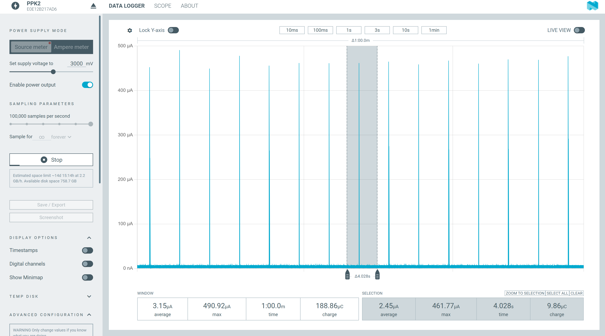

*图 12:nRF54LS05 DK,LFRC,RAM 全开,3.0 V,100 000 样点/秒。纵轴 0~500 µA。*

平均电流(1 分钟窗口):**3.15 µA**,窗口最大 490.92 µA,电荷 188.86 µC。每 4 秒左右一个约 450~490 µA 的校准脉冲。

## 4. 规格书参考值

下面是规格书里的值,不是本次测试的数据。

### 4.1 nRF54L15(Datasheet,Current consumption)

测试条件:3 V、25 °C、DC/DC、CPU 处于 WFI/WFE 休眠、外设空闲、HFCLK = HFINT 128 MHz。典型值,单位 µA。

| 符号 | 说明 | 典型值 |
|---|---|---|
| IOFF0 | System OFF,Wake on pin,保留 0 KB RAM | 0.7 |
| IOFF1 | System OFF,Wake on pin + GRTC,LFXO,保留 0 KB RAM | 0.9 |
| ION_IDLE0 | System ON,Wake on pin,保留 0 KB RAM | 0.8 |
| ION_IDLE1 | System ON,Wake on pin,保留 64 KB RAM | 1.3 |
| ION_IDLE2 | System ON,Wake on pin,保留 96 KB RAM | 1.5 |
| ION_IDLE3 | System ON,Wake on pin,保留 128 KB RAM | 1.8 |
| ION_IDLE4 | System ON,Wake on pin,保留 192 KB RAM | 2.3 |
| ION_IDLE5 | System ON,Wake on pin,保留 256 KB RAM | 2.7 |
| ION_IDLE6 | System ON,Wake on pin + GRTC,LFXO,保留 64 KB RAM | 1.5 |
| ION_IDLE7 | System ON,Wake on pin + GRTC,LFXO,保留 128 KB RAM | 1.9 |
| ION_IDLE8 | System ON,Wake on pin + GRTC,LFXO,保留 256 KB RAM | 2.9 |
| ION_IDLE9 | System ON,Wake on pin + GRTC,LFRC,保留 256 KB RAM | 3.5 |

低频时钟(LFCLK):LFRC 未校准误差最大 ±4.5%;校准后最大 ±250 ppm(温度变化在 ±0.5 °C 以内,至少每 8 秒校准一次);LFXO 启动时间典型 0.43 s,LFRC 启动时间典型 1000 µs。

### 4.2 nRF54LM20A / nRF54LM20B(Datasheet v1.0,Current consumption)

测试条件:3 V on VDD、25 °C、DC/DC、CPU 处于 WFI/WFE 休眠、外设空闲、HFCLK = HFINT 128 MHz、LFCLK 不运行(除非该行注明)。System ON 的 RAM 值是上电的 RAM 量,System OFF 的 RAM 值是保留的 RAM 量。典型值,单位 µA。

| 符号 | 说明 | 典型值 |
|---|---|---|
| IOFF0 | System OFF,Wake on pin,保留 0 KB RAM | 0.7 |
| IOFF1 | System OFF,Wake on pin + GRTC,LFXO,保留 0 KB RAM | 1.0 |
| IONIDLE0 | System ON,Wake on pin,保留 32 KB RAM | 1.1 |
| IONIDLE1 | System ON,Wake on pin,保留 512 KB RAM | 4.0 |
| IONIDLE2 | System ON,Wake on pin + GRTC,LFXO,保留 512 KB RAM | 4.3 |

### 4.3 nRF54LS05A / nRF54LS05B(Datasheet,Current consumption)

规格书把这几项都标为 **Estimated**(估计值),不是最终的测试值。测试条件这里没有取到(L15 和 LM20 的条件是 3 V、25 °C、DC/DC、CPU 休眠、外设空闲),所以和上面两块板的表只能大致对比。典型值,单位 µA。

| 符号 | 说明 | 典型值 |
|---|---|---|
| IOFF0 | System OFF,Wake on pin,保留 0 KB RAM | 0.6 |
| IOFF1 | System OFF,Wake on pin + GRTC,LFXO,保留 0 KB RAM | 0.7 |
| IONIDLE | System ON,Wake on pin + GRTC,LFXO,96 KB RAM | 1.2 |
